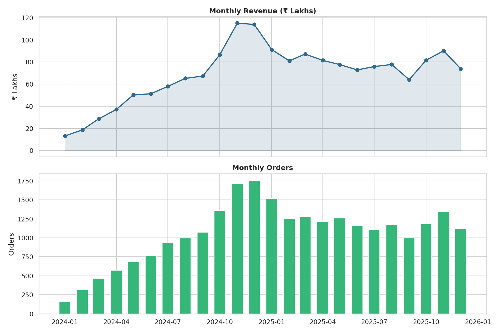
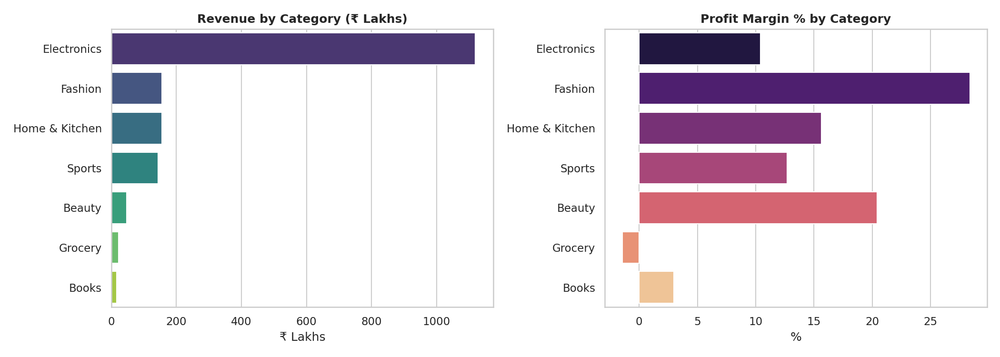
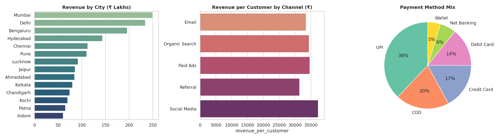
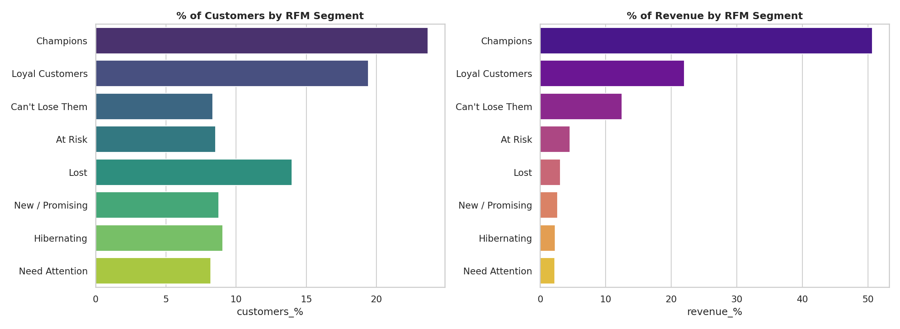
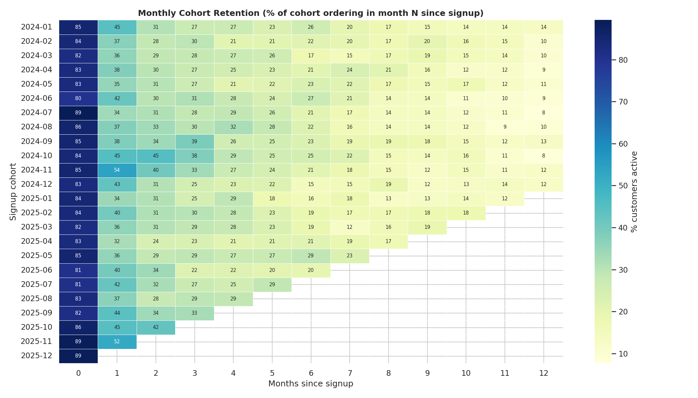
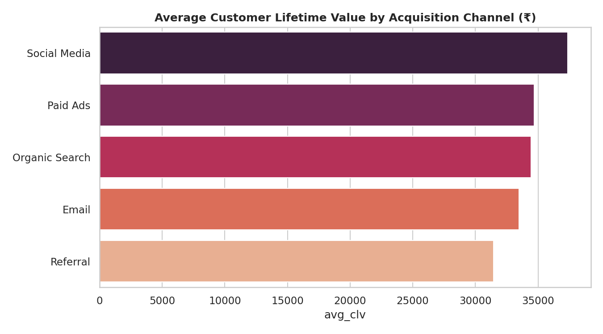
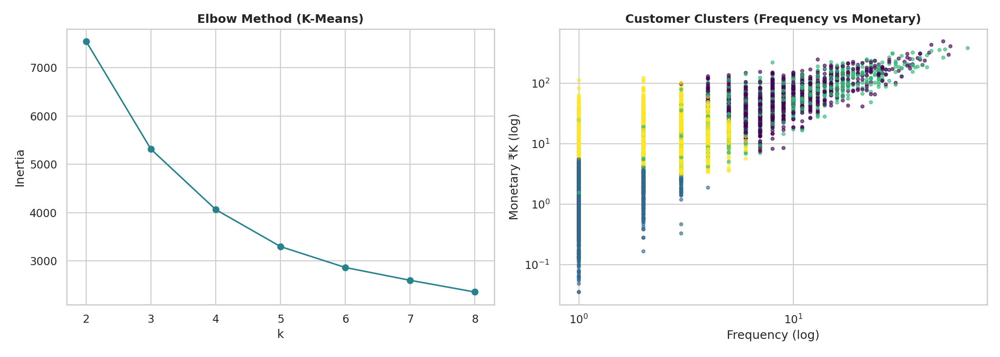

# 🛒 E-Commerce Business Intelligence & Customer Analytics

End-to-end analytics project on an Indian e-commerce business: **sales performance, product profitability, customer segmentation (RFM), cohort retention, Customer Lifetime Value (CLV) and K-Means clustering** — with Python and production-style SQL.

> **Data note:** The dataset is **synthetic** (generated by `src/generate_data.py` with a fixed random seed), designed to mimic Indian e-commerce behaviour (UPI/COD payments, festive-season spikes, metro-city concentration). All numbers below come from this simulated data, not a real company.

---

## Business Questions Answered
1. How is revenue, profit and AOV trending month over month?
2. Which categories drive revenue — and which actually drive **profit**?
3. Who are our best customers and who is about to churn? (RFM)
4. How well do we retain customers after signup? (Cohort analysis)
5. Which acquisition channel brings the most valuable customers? (CLV)
6. What natural customer groups exist in the data? (K-Means)

## Dataset (2 years: Jan 2024 – Dec 2025)
| Table | Rows | Description |
|---|---|---|
| `customers` | 5,000 | signup date, city, gender, age, acquisition channel |
| `products` | 280 | 7 categories, price, cost |
| `orders` | 28,890 | date, value, payment method, status (Delivered / Returned / Cancelled) |
| `order_items` | 52,042 | product, quantity, discount per order line |

## Tech Stack
Python · Pandas · NumPy · Matplotlib · Seaborn · Scikit-learn · SQL (PostgreSQL/MySQL compatible)

## Project Structure
```
ecommerce-bi-customer-analytics/
├── data/                  # generated CSVs
├── src/
│   ├── generate_data.py   # synthetic data generator
│   └── analysis.py        # full analysis pipeline
├── sql/business_queries.sql   # 10 business queries (window functions, CTEs, cohorts, RFM)
├── images/                # charts used in this README
├── outputs/               # result tables (CSV) + insights.json
├── requirements.txt
└── README.md


## Key Results

| KPI | Value |
|---|---|
| Revenue (delivered orders) | **₹16.6 Cr** |
| Profit | **₹2.13 Cr** (12.8% margin) |
| Delivered orders | 25,417 |
| Active customers | 4,795 |
| Average Order Value | ₹6,531 |
| Repeat customer rate | 73.1% |
| Return / Cancellation rate | 7.1% / 5.0% |
| Average CLV (historical) | ₹34,617 |

### 1. Sales Trend
Revenue grows steadily through 2024, peaks in **Nov 2024 (₹1.15 Cr)** on festive-season demand, then settles around ₹70–90 L/month.


### 2. Category Performance
- **Electronics = ~67% of revenue** but only **10.4% margin**.
- **Fashion has the best margin (28.4%)**, followed by Beauty (20.4%).
- **Grocery is slightly loss-making (−1.5%)** — discounts exceed its thin margin; Books are barely profitable (3.0%).



### 3. City, Channel & Payments
Mumbai is the top city (₹2.5 Cr). **Social Media** customers have the highest revenue per customer (₹37.3K) and **Referral** the lowest (₹31.4K).


### 4. RFM Customer Segmentation
- **Champions are 23.7% of customers but generate 50.7% of revenue.**
- Top 20% of customers contribute **62.6%** of revenue (Pareto effect).
- "Can't Lose Them" (8.3% of customers, 12.5% of revenue) are high-value customers who have gone quiet — the top win-back target.



### 5. Cohort Retention
Average retention: **38% (M1) → 26% (M3) → 16% (M6) → 5% (M12)**. The sharpest drop happens in the first month after signup.


### 6. CLV by Acquisition Channel


### 7. K-Means Clustering (k=4 on log-scaled RFM)
Clusters separate into: *active high-value*, *lapsed high-value*, *occasional mid-value* and *one-time low-value* buyers.


---

##  Business Recommendations
1. **Protect Champions** – early access to sales, loyalty tiers; they carry half of revenue.
2. **Win-back campaign for "Can't Lose Them" & "At Risk"** – personalised offers; they were high-frequency buyers.
3. **Fix the Month-1 drop-off** – onboarding emails, second-purchase coupon within 30 days.
4. **Reprice / cut discounts on Grocery & Books**, push high-margin Fashion and Beauty in cross-sell.
5. **Shift acquisition budget toward Social Media**, and review the Referral programme economics.
6. **Reduce Electronics dependency** – 67% revenue concentration is a risk.

##  Methodology Notes
- Revenue counts only **Delivered** orders; profit = net item revenue − cost × quantity.
- RFM: quintile scores (R reversed), 8 rule-based segments.
- Cohorts: grouped by signup month; retention = % of cohort placing ≥1 delivered order in month N.
- Predictive CLV (`outputs/customer_clv.csv`) is a simple heuristic (AOV × orders/month × 12 × M6 retention), not a probabilistic BG/NBD model.

##  Future Work
Power BI / Tableau dashboard · BG/NBD + Gamma-Gamma CLV · churn prediction model · market-basket analysis · Streamlit app.

##  Author
**<SAURABH PAL GAUTAM>** · [LinkedIn](https://www.linkedin.com/in/saurabh-pal-gautam-ab7b60308?utm_source=share_via&utm_content=profile&utm_medium=member_android) · 
[GitHub](https://github.com/saurabhazad1913-afk)

Licensed under the MIT License.
